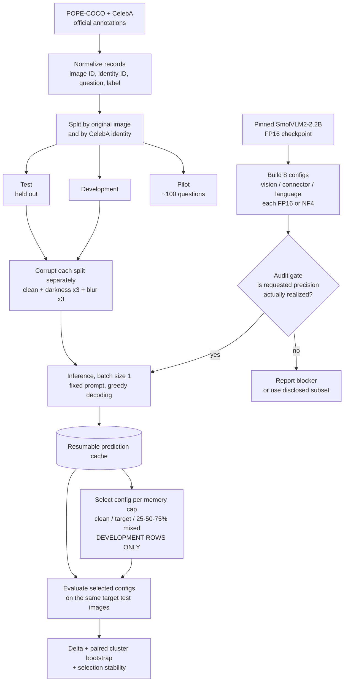
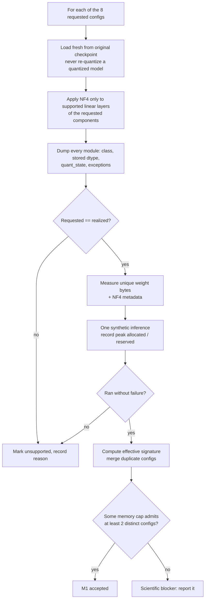

# Midterm Progress: M0–M2 Environment, Component-Control Audit, and Data Pipeline

**Scope:** milestones M0–M2.
**Revised:** 2026-10-29. First written 2026-10-27, before the CUDA audit completed.

This is a progress report. **No task-accuracy experiment has been run and there
is no Δ result.** Every statement is labelled as one of:

- **Measured** — produced by code that actually ran, cited to its source.
- **Implemented, not run** — code exists but has not executed on target hardware or real data.
- **Estimated** — planning figures with no evidential weight.
- **Proposed** — design choices to be checked in the pilot and frozen before the main run.

Related documents: the protocol is in [EXPERIMENT_PROTOCOL.md](EXPERIMENT_PROTOCOL.md),
the milestone plan in [IMPLEMENTATION_PLAN.md](IMPLEMENTATION_PLAN.md), and the
proposal in [PROPOSAL_SNAPSHOT.md](PROPOSAL_SNAPSHOT.md). The full audit report is
[M1_MAC_FINDINGS.md](M1_MAC_FINDINGS.md), the pipeline handoff is
[M2_PIPELINE.md](M2_PIPELINE.md), the real-data validation is
[M2_REAL_DATA_VALIDATION.md](M2_REAL_DATA_VALIDATION.md), and the architecture
and compute analysis is [PROJECT_DEEP_DIVE.md](PROJECT_DEEP_DIVE.md).

---

## 0. Headline for this reporting period

**M1 is complete and accepted.** The project's single largest scientific risk —
whether the vision encoder, connector, and language backbone can be quantized
*independently*, rather than a loader merely accepting a flag — has been
resolved by a measured per-module audit of all eight configurations on an NVIDIA
T4. Independent component control works. No model or quantizer fallback is
needed.

**M2 is implemented and validated on real POPE-COCO data.** The corruption,
split, and annotation pipeline exists, is tested, and has been checked against
the official POPE files and CelebA annotations.

**What is still absent:** any accuracy number. No pilot has run, no real image
has been through the model, and no severity, split size, or memory cap is
frozen. The transfer-penalty measurement the project exists to produce has not
started.

---

## 1. Milestone status at a glance

| Milestone | State |
|---|---|
| **M0** — environment and access | **Done.** Mac development environment and Colab CUDA environment both pinned and measured |
| **M1** — component-control audit | **Accepted.** All 8 configurations audited on a T4; 331/331 linear modules converted as requested; savings exactly additive |
| **M2** — data and corruption pipeline | **Implemented and unit-tested** (42 tests). POPE-COCO validated on real data; CelebA annotations validated, images not yet downloaded |
| **M3** — pilot, cache, protocol freeze | Not started. Blocked only on team decisions listed in §7 |
| **M4** — selection and statistics | Not started |
| **M5** — main runs and report | Not started |

---

## 2. Environment setup (M0)

The project needs two environments, because bitsandbytes NF4 requires an NVIDIA
CUDA GPU and has no Apple Silicon backend.

| | Development environment | Experiment environment |
|---|---|---|
| Host | Apple Silicon Mac | Google Colab, NVIDIA Tesla T4 (free tier) |
| Purpose | Write code, inspect modules, run unit tests, FP16 load on CPU | FP16 and NF4 GPU inference, memory measurement |
| Python | 3.11.17 (Conda env `mpvs-m1`) | 3.13.16 |
| PyTorch | 2.14.1 | 2.11.0+cu130 (CUDA 13.0) |
| Transformers | 4.52.4 | 4.52.4 (matched) |
| Accelerate | 1.15.0 | 1.15.0 |
| bitsandbytes | not available | 0.50.2 |
| Compute capability | n/a (`mps_available=False`) | 7.5 |
| State | **Measured**: FP16 checkpoint loads on CPU; `pytest` clean | **Measured**: all 8 configurations built and ran (§4) |

### Pinned model

```text
Model:     HuggingFaceTB/SmolVLM2-2.2B-Instruct
Revision:  482adb537c021c86670beed01cd58990d01e72e4  (model and processor)
```

Transformers 5.20.1 was tried and **rejected** after its SmolVLM image-token
merger failed. 4.52.4 is the recorded working version on both hosts. This is a
real compatibility finding, not a version preference: it was discovered by
running the smoke test, not by reading release notes.

### Reproducing

```bash
# development
conda env create -f environment-macos.yml
conda activate mpvs-m1
python -m pip install -e .
PYTHONPATH=src python -m pytest -q
python scripts/preflight.py --output artifacts/preflight-macos-m1.json
```

For the experiment environment, open
[`notebooks/m1_colab_cuda_nf4.ipynb`](../notebooks/m1_colab_cuda_nf4.ipynb) in
Colab, select a T4 GPU, and run all cells. The notebook installs the project,
runs FP16 / uniform-NF4 / language-NF4 as a feasibility gate, then runs all
eight candidates in fresh subprocesses, preserves failure JSON, summarizes
acceptance, and downloads the artifacts. Generated artifacts stay untracked.

### 2.1 First GPU measurement: FP16 only (measured, 2026-10-27)

This was the project's first GPU evidence, recorded before the full audit and
retained because it independently reproduces the FP16 reference.

| Measurement | Value |
|---|---:|
| Load time (includes first download) | 143.1 s |
| Peak allocated after load | 4,504,592,896 B |
| Peak reserved during inference | 5,322,571,776 B |
| Synthetic inference (first call, 4 new tokens) | 3.92 s |

Two cross-checks fall out of this, and both passed:

- Peak allocated after load is ~11 MB above the measured 4,493,569,888 bytes of
  FP16 weights — consistent with weights plus small runtime overhead.
- 5,322,571,776 bytes is **4.957 GiB**, which is *exactly* the peak reserved
  figure the independent full audit later recorded for the FP16/FP16/FP16
  candidate (§4). Two separately written runs agree to the byte.

The first attempt at this notebook failed at processor loading because
`num2words` was missing from the Colab install list. An earlier attempt also
cloned a published commit that predated the M1 implementation and stopped at
`pip install -e .`. Both were infrastructure failures that produced no evidence;
the clone cell now fails early with a stale-branch diagnostic. Recording them
matters because the protocol distinguishes infrastructure failures from model
answers.

---

## 3. Pipeline flow

### 3.1 End to end



M0–M2 cover everything above the inference step. The audit gate has now been
passed; M3–M5 (pilot freeze, caching, selection, statistics) come next.

### 3.2 The M1 audit gate



Every branch of this gate was exercised. The outcome was the left path at every
decision point.

---

## 4. What M1 measured

All figures in this section are **measured** on a Tesla T4, each candidate
loaded freshly from the same original checkpoint.

### 4.1 Component control is real

| Component | Supported linear modules | Converted to NF4 | Exceptions |
|---|---:|---:|---|
| Vision encoder (`model.vision_model`) | 162 | 162 | none |
| Connector (`model.connector`) | 1 | 1 | none |
| Language backbone (`model.text_model`) | 168 | 168 | `lm_head` kept FP16 |
| **Total** | **331** | **331** | one documented output-head exception |

Across all eight audit reports: every requested NF4 module is a real
`bitsandbytes Linear4bit` converted from `torch.nn.Linear`; every one reports
NF4 storage, FP16 compute, uint8 quantized storage, and no double quantization;
every requested FP16 component has zero quantized modules; `lm_head` stayed
FP16; every mismatch list is empty; no unclassified module was quantized; and
all eight effective signatures are distinct.

This is the sentence the protocol demanded: **the audit validates independent
component control, and it is not global quantization relabelled as mixed
precision.**

### 4.2 Measured weight storage

| Vision | Conn. | Backbone | Weight bytes | GiB | Peak reserved GiB | Gen. s |
|---|---|---|---:|---:|---:|---:|
| NF4 | NF4 | NF4 | 1,556,898,080 | 1.450 | 2.283 | 3.98 |
| NF4 | FP16 | NF4 | 1,587,421,408 | 1.478 | 2.283 | 4.05 |
| FP16 | NF4 | NF4 | 2,147,801,504 | 2.000 | 2.600 | 3.90 |
| FP16 | FP16 | NF4 | 2,178,324,832 | 2.029 | 2.627 | 3.89 |
| NF4 | NF4 | FP16 | 3,872,143,136 | 3.606 | 4.182 | 3.98 |
| NF4 | FP16 | FP16 | 3,902,666,464 | 3.635 | 4.213 | 3.85 |
| FP16 | NF4 | FP16 | 4,463,046,560 | 4.157 | 4.781 | 4.01 |
| FP16 | FP16 | FP16 | 4,493,569,888 | 4.185 | 4.957 | 3.78 |

All eight returned a successful deterministic generation on a synthetic
384×384 image. **This checks execution viability only** — it is not accuracy,
robustness, real-image, or throughput evidence.

### 4.3 The strongest check: savings are exactly additive

Holding the other two components at FP16, moving one component to NF4 saved:

| Component | Bytes saved |
|---|---:|
| Vision encoder | 590,903,424 |
| Connector | 30,523,328 |
| Language backbone | 2,315,245,056 |

```
4,493,569,888 − 590,903,424 − 30,523,328 − 2,315,245,056 = 1,556,898,080
```

That is exactly the measured all-NF4 total. Perfect additivity means the three
component controls do not contaminate each other — independently confirming
§4.1 at the storage level, by a different route.

### 4.4 Storage is fully accounted for

For the all-NF4 candidate:

| Category | Bytes |
|---|---:|
| Parameter storage | 1,429,194,464 |
| Persistent buffers | 128 |
| Exposed quantization metadata | 127,703,488 |
| Total | 1,556,898,080 |

127,703,488 bytes across 2,042.9 M quantized parameters is **0.0625
bytes/param** — exactly one FP32 `absmax` per 64-value block, consistent with
double quantization being off. Nothing in the storage total is unexplained.

### 4.5 The prediction held

The architecture analysis derived these totals from the published
`config.json` *before* any GPU was available. Every candidate landed within
1.4 MB of its measured value, a maximum error of **0.090%**. The storage model
is therefore validated, and the memory cost of future candidate changes can be
computed without spending GPU time.

### 4.6 Usable memory caps

| Cap (bytes) | Eligible candidates | Vision varies | Backbone varies |
|---|---:|---|---|
| 1,587,421,408 | 2 | no | no |
| 2,147,801,504 | 3 | yes | no |
| **2,178,324,832** | **4** | **yes** | no |
| 3,872,143,136 | 5 | yes | yes |
| **3,902,666,464** | **6** | **yes** | **yes** |

M1 acceptance required only one cap admitting two distinct candidates, and
1,587,421,408 bytes satisfies it. But it is the **weakest** scientific choice:
its two candidates differ *only* in connector precision, which is 0.9% of the
weights. The caps admitting four and six candidates vary vision and backbone
precision and are the useful comparisons. **Proposed**, not frozen.

---

## 5. M2 — data and corruption pipeline

M2 needs no GPU and proceeded in parallel with M1.

### 5.1 Order of operations (this order is the leakage guarantee)

1. Build normalized records: `dataset, original_image_id, identity_id, question_id, question, label`.
2. **Split first**, by whole group, into pilot / development / test with a fixed seed. Save manifests with checksums.
3. **Then** generate corrupted variants. Every variant inherits its original image's split.
4. Never let a group appear in two splits, even if split sizes end up uneven.

Grouping is correct by construction: the split group resolves to the CelebA
identity and to the POPE original image, so no identity and no image can
straddle a split.

### 5.2 POPE-COCO: validated on real data

The three official POPE COCO files and the 500 referenced COCO val2014 images
were downloaded and checked. **Measured**, for every sampling variant:

| Check | Result |
|---|---|
| Questions | 3,000 |
| Distinct images | 500 |
| Yes/no balance | 1,500 / 1,500 |
| Questions per image | 6 |
| Duplicate question IDs | none |
| Missing images | none |
| Loader defaults vs. schema | matched, no code change needed |
| Normalization | deterministic |

### 5.3 CelebA: annotations validated, images pending

Attribute and identity files match their published MD5 values. **Measured**:
202,599 images, 40 attributes, 10,177 identities, and every image has an
identity.

615 identities carry inconsistent `Male` labels across their images. This is
dataset label noise to **document, not repair** — silently correcting source
labels would be an undisclosed change to the benchmark.

The images themselves are not yet downloaded, so no CelebA split is final.

### 5.4 Validation results

Trial splits on POPE adversarial and CelebA Eyeglasses (placeholder seed):
**zero leakage, byte-identical on rerun**. Trial POPE pilot corruptions: 420
variants, completeness valid, **0 pixel mismatches across two renders**.

Two real defects were found by validation review and fixed:

1. `validate_variant_inheritance` reported `valid: true` when some
   clean/darkness/blur variants were **missing**, which silently breaks paired
   evaluation. It now reports missing variants, inconsistent corruption specs,
   and undeclared specs, and the CLI passes declared specs so a condition
   dropped for every question is also caught.
2. Splits did not detect **the same image bytes appearing under two image IDs
   or two identities** in different splits. Groups sharing a source-image
   checksum are now merged into one indivisible unit, and the validator reports
   checksum leakage.

Nine synthetic-fixture tests were added; eight of them fail against the
previous code. The second defect is the dangerous class — a leakage hole that
raises no error and would have invalidated the study silently.

A third defect was found in the corruption specification and fixed:
`CorruptionSpec.value` was not normalized, so `2` and `2.0` produced different
signature digests and `True` was accepted as a blur radius (`bool` subclasses
`int`). One transform could hold three distinct cache keys. Since cache keys
must include the image transformation, this was a correctness defect. `value`
is now coerced to `float`, booleans are rejected, and two regression tests
cover it.

**Command:** `PYTHONPATH=src python3 -m pytest -q` → **42 passed** (Python
3.13, macOS, CPU). Synthetic fixtures only; synthetic success is not research
evidence.

---

## 6. Risks, with current status

| # | Risk | Status | Mitigation |
|---|---|---|---|
| 1 | **GPU access** | **Resolved.** Free-tier Colab T4 ran the full audit | Keep the Mac for code and tests; T4 is the known-working path |
| 2 | **Component control may not work** | **Resolved.** 331/331 modules, zero mismatches, additive savings | Keep the audit as a gate whenever the grid or library versions change |
| 3 | **Throughput** | **Open — now the top risk.** Only measurement is 3.78–4.05 s/answer, a cold first call including warm-up | At 4 s, ~95,000 answers is ~106 GPU-hours; at 1 s, ~26. Measure steady state in the pilot before committing |
| 4 | **Blur severity is not comparable across domains** | **Open — newly identified.** Gaussian radius is in absolute pixels; a CelebA crop is ~178 px wide and a COCO image ~640 px, so one radius is far stronger on faces | Define radius relative to the short edge, or declare severities per-domain and never compare a raw severity across domains |
| 5 | **Double quantization shifts every cap** | **Open decision.** Currently off, costing ~128 MB of metadata | Freeze before the pilot alongside the cap definitions |
| 6 | **Colab session limits** | Open | Batch size 1, one config per process, resumable cache so a disconnect loses at most one item. At the pessimistic throughput, free tier is not viable — budget a paid runtime |
| 7 | **Severity window** | Open | The pilot must show accuracy declining with severity without collapsing to chance; choose levels on pilot data only |
| 8 | **Connector result is ambiguous** | Open by construction | The connector is a single 21 M-param layer, so a null cannot distinguish "no effect" from "lever too small". Report the weaker reading |
| 9 | **Selection noise** | Open | Report selection frequencies under development bootstrap alongside Δ |
| 10 | **Invalid answers bias the result** | Open | Count invalid as incorrect, freeze the parser before selection, report invalid rate per configuration |
| 11 | **8 GB assumption** | Largely resolved | Largest configuration peaked at 4.957 GiB with one synthetic image; re-check with real images in the pilot |
| 12 | **Dataset access and terms** | Open | CelebA images stay internal under its research-use agreement; release code and split identifiers only |
| 13 | **Schedule** | Open | The proposal's Oct 12 protocol freeze and Oct 19 main-run dates have passed. M1 and M2 are now done, so the critical path is the pilot |

---

## 7. Next actions

Decisions first — none of them need a GPU, and the pilot cannot be frozen
without them:

| Action | Needs GPU |
|---|---|
| Freeze NF4 double quantization on or off | No |
| Decide blur severity units: absolute pixels or relative to image size | No |
| Choose the POPE sampling variant and the CelebA attribute set | No |
| Approve the identity-capped balanced CelebA sampling rule, split sizes, and seed | No |
| Download CelebA images under the research-use agreement; build final manifests | No |
| Run the human answerability review on corrupted pilot variants | No |
| **Measure steady-state throughput**, then choose severities and caps | Yes |
| Implement the resumable prediction cache before any scaled run | Yes |

Nothing above should be reported as GPU-tested or as an experimental result
until the corresponding run has completed and its outputs are recorded.

---

## 8. Honest summary

The infrastructure phase of this project is finished and it is in better shape
than the schedule suggests. Component control — the assumption the whole study
rests on — is not assumed but measured, at the level of all 331 individual
linear modules, with an independent additivity cross-check and an exact
match to a prediction made beforehand. The data pipeline is implemented, and
validation review has already caught three defects, one of which was a silent
leakage hole.

What remains is the experiment itself, and it has not started. There is no
accuracy figure, no Δ, and nothing frozen. The honest position is that the
project is roughly two weeks behind the proposal's timeline on *results* while
being ahead of where most projects are on *verification*, and that the single
number which decides whether the full design is affordable — steady-state
inference throughput — is still unmeasured.
