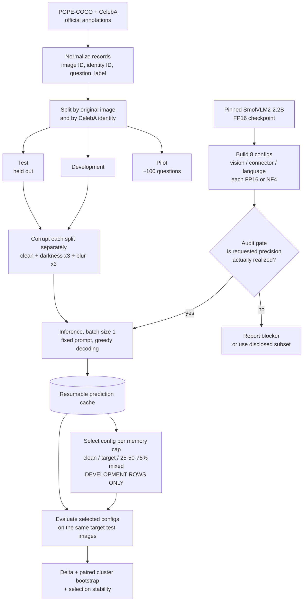
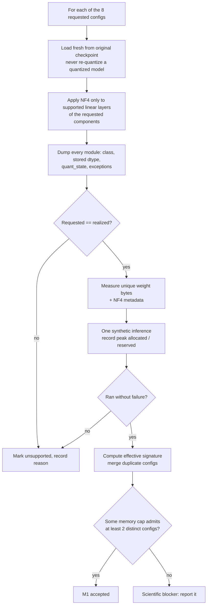

# Midterm Progress: M0–M2 Environment, Pipeline Flow, M1 Validation Plan, and Risks

**Author:** Gauri Chabukswar (evaluation and validation)
**Written:** 2026-10-27
**Scope:** milestones M0–M2 only, per the team's midterm plan.

This is a progress and planning document, not a results document. **No
experiment has been run.** Every statement below is labelled as one of:

- **Measured** — produced by code that actually ran (cited to its source).
- **Implemented, not run** — code exists in the repository but has not executed on the target hardware.
- **Estimated** — planning figures with no evidential weight.
- **Proposed** — design choices to be checked during the pilot and frozen before the main run.

Related documents: the protocol is in [EXPERIMENT_PROTOCOL.md](EXPERIMENT_PROTOCOL.md),
the milestone plan in [IMPLEMENTATION_PLAN.md](IMPLEMENTATION_PLAN.md), and the
proposal in [PROPOSAL_SNAPSHOT.md](PROPOSAL_SNAPSHOT.md). Kaushal's Mac M0/M1
work is documented in
[`M1_MAC_FINDINGS.md` on `Kaushal-Commits`](https://github.com/Omkar38/mixed-precision-visual-shift/blob/Kaushal-Commits/docs/M1_MAC_FINDINGS.md),
and Omkar's architecture and compute analysis in
[`PROJECT_DEEP_DIVE.md` on `docs/project-deep-dive`](https://github.com/Omkar38/mixed-precision-visual-shift/blob/docs/project-deep-dive/docs/PROJECT_DEEP_DIVE.md).

---

## 1. Milestone status at a glance

| Milestone | Owner (proposal) | State |
|---|---|---|
| **M0** — environment and access | Team | Mac dev environment pinned and **measured** (Kaushal). CUDA environment **GPU-tested for FP16** on a Colab T4 (Gauri, 2026-10-27; see §2.1). |
| **M1** — component-control audit | Kaushal (lead), Gauri (validation) | FP16 audit **implemented and CPU-load-tested**. FP16 load and one synthetic inference **GPU-tested** on a T4. NF4 construction and audit **not started on GPU**. Acceptance not met. |
| **M2** — data and corruption pipeline | Kaushal (lead), Gauri (validation) | **Proposed** design below. No code yet. Does not need a GPU, so it can proceed in parallel with M1. |

---

## 2. Environment setup (M0)

The project needs two environments, because the quantizer we use
(bitsandbytes NF4) requires an NVIDIA CUDA GPU and has no Apple Silicon backend.

| | Development environment | Experiment environment |
|---|---|---|
| Host | Apple M5 Mac | Google Colab, NVIDIA T4 GPU (free tier; L4 also accepted) |
| Owner | Kaushal | Gauri |
| Purpose | Write code, inspect modules, run unit tests, FP16 load on CPU | FP16 and NF4 GPU inference, memory measurement |
| Python | 3.11.17 (Conda env `mpvs-m1`) | 3.13 (Colab default) |
| PyTorch | 2.14.1 | 2.11.0+cu130 (Colab preinstalled, CUDA 13.0) |
| Transformers | 4.52.4 | 4.52.4 (matched to Mac) |
| Accelerate | 1.15.0 | 1.15.0 |
| bitsandbytes | not available | 0.50.2 (installed, not yet exercised) |
| State | **Measured**: FP16 checkpoint loads; `pytest` 7 passed; `pip check` clean | **Measured**: FP16 loads and generates on GPU (§2.1) |

### Pinned model

```text
Model:     HuggingFaceTB/SmolVLM2-2.2B-Instruct
Revision:  482adb537c021c86670beed01cd58990d01e72e4  (model and processor)
```

Transformers 5.20.1 was tried on the Mac and **rejected** after its SmolVLM
image-token merger failed. 4.52.4 is the recorded working version (Kaushal,
see `DECISIONS.md` on `Kaushal-Commits`).

### Reproducing the development environment

```bash
conda env create -f environment-macos.yml   # on Kaushal-Commits
conda activate mpvs-m1
python -m pip install -e .
python -m pytest -q
python scripts/preflight.py --output artifacts/preflight-macos-m1.json
```

### Reproducing the experiment environment

Open [`notebooks/m1_colab_cuda_nf4 gauri.ipynb`](<../notebooks/m1_colab_cuda_nf4 gauri.ipynb>)
in Colab, select **Runtime → Change runtime type → T4 GPU** (free) or **L4 GPU**, and run all cells.
The notebook:

1. Refuses to continue unless `nvidia-smi` reports a T4 or L4.
2. Clones this branch and records the exact commit it ran from.
3. Installs the pinned Transformers/Accelerate plus bitsandbytes, keeping Colab's CUDA PyTorch.
4. Runs `scripts/preflight.py` and saves `artifacts/preflight-colab-{t4,l4}.json`.
5. Loads the pinned FP16 checkpoint and checks the parameters really are FP16.
6. Runs one synthetic image-question generation (greedy, 4 new tokens).
7. Saves load time, inference time, and peak **allocated** and **reserved** GPU memory separately to `artifacts/m1-colab-{t4,l4}-fp16-smoke.json`.

It deliberately does **not** build an NF4 model; that is the next M1 step.
Generated artifacts stay out of tracked files.

The first attempt failed at processor loading because `num2words` was missing
from the Colab install list (the Mac environment already had it). It was added
in commit `8b55db6`, and the second attempt succeeded.

### 2.1 First GPU measurement: FP16 on a Colab T4 (measured, 2026-10-27)

Run from `Gauri-Commits` at commit `8b55db6`, using the pinned model revision.
The notebook saved `artifacts/m1-colab-t4-fp16-smoke.json` in the Colab session (not tracked); the values below are copied from its printed output.

| Measurement | Value |
|---|---:|
| GPU | Tesla T4 (16 GB) |
| PyTorch / CUDA | 2.11.0+cu130 / 13.0 |
| Transformers / Accelerate / bitsandbytes | 4.52.4 / 1.15.0 / 0.50.2 |
| Parameter dtype after load | `torch.float16` (checked) |
| Load time (includes first download) | 143.1 s |
| Peak allocated after load | 4,504,592,896 B (4.50 GB) |
| Peak reserved after load | 4,735,369,216 B (4.74 GB) |
| Synthetic inference time (first call, 4 new tokens) | 3.92 s |
| Peak allocated during inference | 4,932,262,912 B (4.93 GB) |
| Peak reserved during inference | 5,322,571,776 B (5.32 GB) |
| Answer to "Is the image blue? Answer yes or no." on a solid blue image | `Yes.` |

What this shows:

- **FP16 runs on a CUDA GPU** with the pinned model and Transformers 4.52.4. This is the first GPU evidence in the project.
- **The GPU load matches the Mac storage measurement.** Peak allocated after load is only about 11 MB above Kaushal's measured 4,493,569,888 bytes of FP16 weights.
- **FP16 fits within 8 GB for this input.** Peak reserved memory during inference was 5.32 GB, about 3.3 GB below 8 GiB. That supports the proposal's 8 GB assumption for the largest configuration, but only for one 384×384 synthetic image and 4 output tokens. Real images may be split into more image tokens and use more memory, so this must be re-checked in the pilot.
- **Output format note for the parser.** The model answered `Yes.` with a capital and a full stop. The proposed strict parser (case-insensitive, optional final punctuation) would accept this. One synthetic answer says nothing about accuracy.

What this does **not** show: anything about NF4, per-answer runtime (the
3.92 s includes first-call warm-up), accuracy, or memory with real images.

---

## 3. Proposed pipeline flow

### 3.1 End to end



M0–M2 cover everything above the inference step: environments, the model
and audit gate (M1), and the data, split, and corruption branch (M2).
M3–M5 (pilot freeze, selection, statistics, main runs) come later.

### 3.2 The M1 audit gate in detail



---

## 4. What M1 validation will tell us

These are the **questions M1 will answer and the form of each answer** — not
answers. Nothing in this section is a result.

| # | Question | Output we will produce | Why it matters |
|---|---|---|---|
| 1 | Does the FP16 model run on a CUDA GPU? | Load time, inference time, peak allocated/reserved GPU memory | **Answered for FP16 on a T4 (§2.1).** Establishes the reference configuration |
| 2 | Can each component be quantized independently? | Per-module audit JSON for each of the 8 configs | If not, there is no mixed-precision experiment; the protocol forbids relabelling global quantization as mixed precision |
| 3 | Which configs are feasible? | Supported-candidate list with failure reasons | Defines the candidate set every selection strategy must share |
| 4 | How much memory does each config really use? | Measured weight bytes, including NF4 metadata, per config | Memory caps must come from measurements, not flags |
| 5 | Are any configs duplicates? | Effective signatures; merged list | Fewer distinct configs means less inference |
| 6 | Which memory caps are usable? | Caps that admit at least two distinct feasible configs | Required before any selection comparison |

### What we expect to see (estimated, to be replaced by measurements)

Omkar's deep dive derives the following weight memory per config from the
published model config, assuming standard NF4 storage (0.5 bytes/param plus
block scales) with embeddings, norms, and `lm_head` left at FP16. The FP16
total matches Kaushal's **measured** 4,493,569,888 bytes. Everything else is
**estimated**.

| Vision | Connector | Language | Est. weight MB |
|---|---|---|---:|
| NF4 | NF4 | NF4 | ~1,556 |
| NF4 | FP16 | NF4 | ~1,586 |
| FP16 | NF4 | NF4 | ~2,147 |
| FP16 | FP16 | NF4 | ~2,177 |
| NF4 | NF4 | FP16 | ~3,871 |
| NF4 | FP16 | FP16 | ~3,902 |
| FP16 | NF4 | FP16 | ~4,462 |
| FP16 | FP16 | FP16 | 4,493 (measured) |

What validation needs to check against this table:

- **Four tight pairs.** The connector is under 1% of the weights, so configs that differ only in the connector should sit about 30 MB apart. If the measurements do not show this pattern, the component mapping or the NF4 coverage is wrong.
- **Large backbone gap.** The language backbone should account for the biggest jump (about 1.7 GB). This is what makes the backbone, not the vision side, decide which memory cap a config falls under.
- **Caps that work.** If the estimates hold, a cap just above ~2.2 GB admits four configs and one near ~3.9 GB admits six, so the "at least two configs" requirement should be easy to meet.
- **Possible duplicates.** If connector precision changes nothing measurable, eight configs become four effective ones. This must be shown by audit signatures and pilot data, not assumed.

### How each M1 outcome changes the plan

| If M1 shows… | Then we… |
|---|---|
| All 8 configs realized and runnable | Proceed with the full grid |
| Some configs fail (e.g., a component cannot be targeted) | Use the disclosed supported subset; narrow the claims; no full factorial analysis |
| Component control is impossible with bitsandbytes | Report a scientific blocker; discuss alternatives as a recorded protocol change, never a silent substitution |
| FP16 does not fit or OOMs at the chosen resolution | Lower resolution or fall back to SmolVLM2-500M as a new protocol version |
| NF4 is much slower than FP16 | Re-estimate compute with real timings before the pilot (see §6) |

---

## 5. M2 — data and corruption pipeline (proposed)

M2 needs no GPU, so it does not have to wait for M1.

### 5.1 Datasets

| | POPE-COCO | CelebA |
|---|---|---|
| Content | Everyday scenes and objects | Aligned face crops |
| Question form | "Is there a {object} in the image?" | "Is this person {attribute}?" built from visible attributes |
| Proposal size | One sampling variant: 3,000 questions over 500 images | Subset of 202,599 images, 40 attributes |
| Group for splitting | Original COCO image | CelebA identity (and image) |
| To decide in pilot | Which POPE variant (random / popular / adversarial) | Which visible attributes; balancing rule |
| Access | COCO images fetched separately; checksum sources | Research-use agreement; keep images internal |

### 5.2 Order of operations (this order is the leakage guarantee)

1. Build normalized records: `dataset, original_image_id, identity_id, question_id, question, label`.
2. **Split first**, by whole group, into pilot / development / test with a fixed seed. Save manifests with checksums.
3. **Then** generate corrupted variants. Every variant inherits its original image's split.
4. Never let a group appear in two splits, even if that means the split sizes are not exactly round.

### 5.3 Corruptions (proposed, severities frozen after pilot)

| Corruption | Proposed implementation | Severities |
|---|---|---|
| Darkness | Multiply RGB intensity by a factor below 1 | 3 levels, chosen from pilot answerability checks |
| Gaussian blur | Documented radius/kernel convention, one library only | 3 levels, chosen the same way |

Together with the clean images, that gives 7 conditions per image. Transforms
must be deterministic and applied at the same point relative to resizing for
every config. Severities are chosen from **pilot data only**, never from test
accuracy.

### 5.4 Validation checks I will write for M2

These come under evaluation and validation, my role in the proposal. All of
them run on clearly labelled synthetic fixtures.

- **No leakage:** no original image ID or CelebA identity appears in more than one split.
- **Variant inheritance:** every corrupted variant has the same split as its original image.
- **Question grouping:** every question about an image stays in that image's split.
- **Determinism:** the same seed and inputs give byte-identical manifests and transformed images.
- **Pilot disjointness:** pilot groups never appear in development or test.
- **Label balance:** report the yes/no ratio per split; record any imbalance caused by whole-group assignment instead of silently rebalancing.

Acceptance (from `IMPLEMENTATION_PLAN.md`): no group crosses splits, all
variants inherit their group, and manifests and transforms are reproducible.

---

## 6. Problems we might face

| # | Problem | Why it is a risk | Mitigation |
|---|---|---|---|
| 1 | **GPU access** | NF4 needs CUDA. The Mac cannot run it, so all of M1's NF4 work depends on Colab or another NVIDIA machine. | Colab notebook works on the free T4 (§2.1). Keep the Mac for code and tests. Consider renting a GPU if Colab access is unreliable. |
| 2 | **Colab session limits** | Sessions can disconnect or time out, and GPU availability and usage quotas are limited. A long run can be lost. | Batch size 1, one config per process, and a **resumable cache** (M3) so a disconnect loses at most the current item. Save artifacts to Drive. |
| 3 | **Compute time** | Proposal design is ~56,000 test answers; including dev and pilot, about **~95,000** (estimated). Omkar estimates **15–40 GPU-hours** at 0.3–1.0 s/answer. NF4 can be *slower* than FP16 because weights are dequantized on the fly. | Measure real per-answer time on the GPU in M1 (the T4 smoke test is first-call only) and replace the estimate. Fallbacks in order: 2 severities instead of 3 (−29% conditions), merge duplicate configs, then SmolVLM2-500M. |
| 4 | **Library compatibility** | Transformers 5.x already broke SmolVLM image-token merging. bitsandbytes must match the CUDA/PyTorch build, and Colab's preinstalled PyTorch can change without notice. | Pin Transformers 4.52.4; record every package version in the notebook's JSON; lock the CUDA environment once it works. |
| 5 | **Component control may not work** | The loader might quantize modules we did not ask for, or skip ones we did. A config the loader accepts is not necessarily the config we wanted. | M1 audit gate (§3.2) checks every module. If it fails, we report a blocker rather than working around it. |
| 6 | **8 GB memory assumption** | The proposal assumed an 8 GB GPU; activations and the KV cache add to weight memory and could cause out-of-memory errors. | First measurement is reassuring: FP16 peaked at 5.32 GB reserved on a synthetic image (§2.1). Re-check with real images during the pilot, and keep reporting weight bytes and peak GPU memory separately. |
| 7 | **Dataset access and terms** | CelebA requires agreeing to research-use terms and cannot be redistributed. COCO images must be fetched separately. | Download only what POPE references (~500 images), keep raw data out of Git, commit only permitted split identifiers. |
| 8 | **Severity window** | Too mild and nothing changes; too severe and every config fails. Either way Δ ≈ 0 for an uninteresting reason. | The pilot must show accuracy dropping as severity increases without collapsing to chance; choose levels on pilot data only. |
| 9 | **Selection noise** | With a small dev set, the best config may change at random, so Δ would measure noise. | Report how often each config is selected under development bootstrap, alongside Δ. |
| 10 | **Schedule** | The proposal's protocol-freeze date (Oct 12) has passed, and the Oct 19 main-run date assumed M1 was done. | Run M2 in parallel with M1 now; aim to finish the FP16 GPU run and NF4 audit first, since they are the critical path. |

---

## 7. Next actions

| Action | Owner | Needs GPU |
|---|---|---|
| ~~Run the Colab FP16 smoke-test notebook~~ Done on T4, 2026-10-27 (§2.1) | Gauri | Yes |
| Implement selective NF4 replacement and run the audit gate for all 8 configs | Kaushal, validated by Gauri | Yes |
| Write the M2 leakage and determinism tests with synthetic fixtures | Gauri | No |
| Implement POPE/CelebA loaders, splits, and corruptions | Kaushal | No |
| Choose the POPE variant and CelebA attributes; record in `DECISIONS.md` | Omkar, with team | No |

Nothing here should be reported as GPU-tested or as an experimental result
until the corresponding run has actually completed and its outputs are
recorded.
